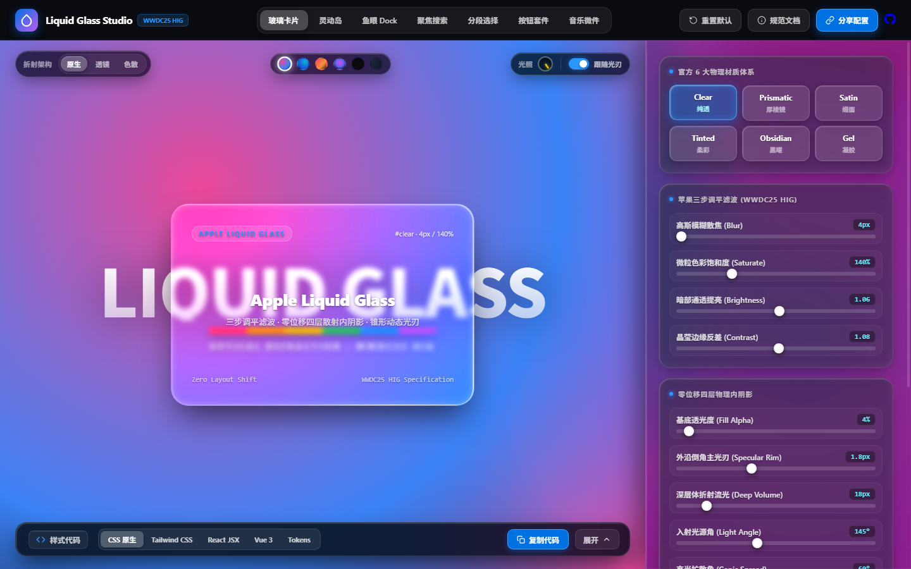
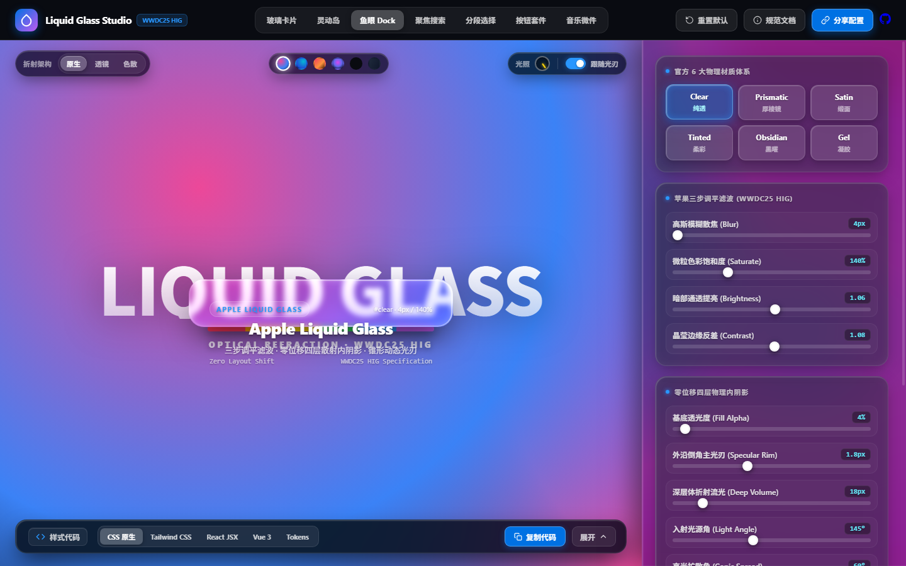
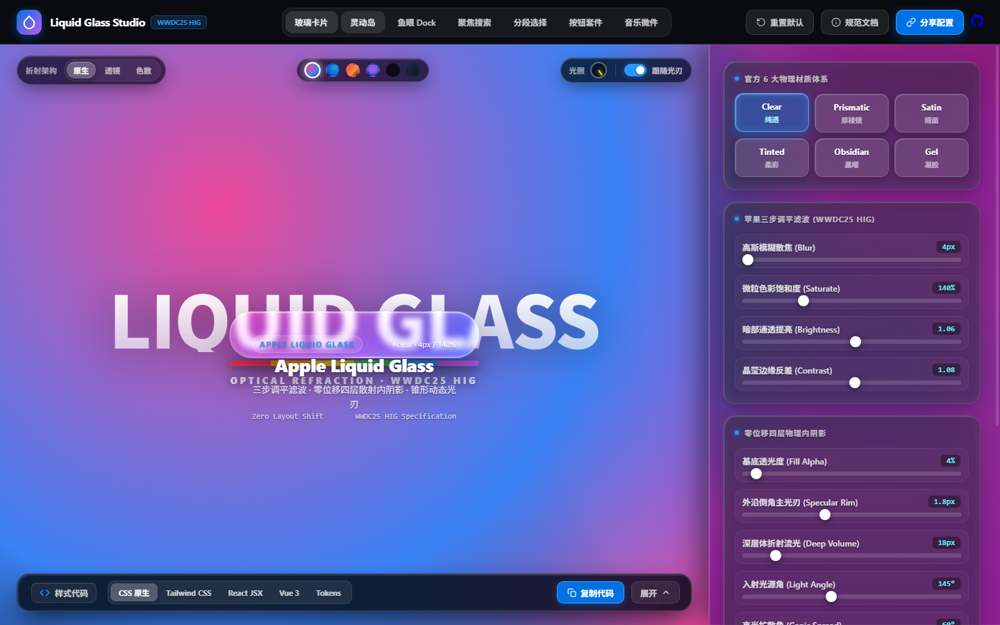
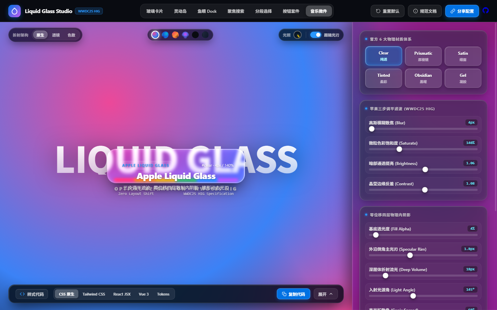

# Apple Liquid Glass Studio (WWDC25 HIG)

<p align="center">
  
</p>

<p align="center">
  <strong>Apple Liquid Glass 苹果液态玻璃全套设计系统与光学折射引擎 (WWDC25 HIG)。零位移物理散射内阴影、真实透镜折射与实时代码生成器。Native CSS / React / Vue.</strong>
</p>

<p align="center">
  <a href="https://github.com/pandaJS404"></a>
  
  
  
  
  
</p>

---

## 🌟 核心特性 (Key Highlights)

- 🪞 **真实透镜法线折射引擎**：内置有向距离场（Signed Distance Field, SDF）边缘法线向量场与动态 Canvas 位移纹理，Chromium 环境下通过 SVG `<feDisplacementMap>` 实现波长彩虹分离与边缘背景折射；在 Safari/Firefox 自动优雅回退至四层散射物理流光。
- 📐 **零位移四层物理内阴影**：彻底弃用容易引发重排的传统 `border`，采用四层级物理散射 `box-shadow: inset`，倒角主光刃、深层体折射流光与环境底光浑然一体，绝不引起 1 像素的重排与布局抖动（Zero Layout Shift）。
- 🎨 **官方 6 大物理材质体系**：出厂标定 **Clear（纯透）**、**Prismatic（厚棱镜）**、**Satin（烟雾）**、**Tinted（全彩）**、**Obsidian（黑曜）** 与 **Gel（凝胶）**。
- 🧩 **全套 7 大 HIG 核心交互载体**：
  1. **主玻璃卡片**（Master Glass Card）
  2. **macOS 鱼眼程序坞**（macOS Fisheye Magnification Dock）
  3. **灵动岛胶囊**（Dynamic Island Live Activity）
  4. **聚焦搜索框**（Spotlight Search Hub）
  5. **分段选择控制器**（Segmented Controls）
  6. **多态液态按键套件**（Multi-state Liquid Button Suite）
  7. **Apple Music 正在播放卡片**（Now Playing Live Waveform Widget）
- ⚡ **多端无缝代码生成**：实时参数同步导出 **Native CSS**、**Tailwind CSS**、**React JSX**、**Vue 3** 及 **Design Tokens (JSON)**，一键复制即用。
- 🌐 **100% 离线脱机运行**：纯原生 HTML5 / CSS3 / ES Modules 构建，零外部 CDN 脚本依赖，打开即用。
- ♿ **WCAG 2.2 AA 无障碍边界防护**：完整支持 `prefers-reduced-transparency`（纯色高反差降级）与 `prefers-reduced-motion`（动态光刃与 3D 倾斜安全平伏）。

---

## 📸 视觉画廊 (Visual Gallery)

### 1. 独立调谐工作台 (Studio & Inspector)
支持自由微调模糊离散、色彩饱和度、高光扩散角、倒角主光刃与拟态平滑圆角，并内置高反差底图标定层：
<p align="center">
  
</p>

### 2. macOS 鱼眼程序坞 (Fisheye Dock)
完整支持平滑向上破界弹出的鱼眼缩放与底部贴合物理特性：
<p align="center">
  
</p>

### 3. 灵动岛胶囊与音乐流媒体组件 (Island & Music Widget)
<p align="center">
  
  
</p>

---

## 🔬 光学物理原理与渲染管线

```
[ 背景高对比度图层 (Typography / Spectrum) ]
                     │
                     ▼
[ 1. 三步调平滤波 (Luminosity Re-leveling) ]
  - 高斯离散模糊 (Blur: 4px ~ 28px)
  - 微粒色彩饱和 (Saturate: 130% ~ 220%)
  - 暗部通透提亮 (Brightness: 0.94 ~ 1.08)
  - 晶莹边缘反差 (Contrast: 1.02 ~ 1.12)
                     │
                     ▼
[ 2. 零位移四层物理内阴影 (Scatter Box-Shadow) ]
  - Layer 1: 入射主光刃 (Specular Rim Inset)
  - Layer 2: 反向背向弱光 (Secondary Bounce Inset)
  - Layer 3: 短程亚表面散射 (Short Scatter Inset)
  - Layer 4: 深层体折射流光 (Deep Volume Bloom Inset)
  - Layer 5: 零接触外悬浮跌落阴影 (Drop Shadow)
                     │
                     ▼
[ 3. 锥形动态跟随光刃 (Conic Rim Specular Glint) ]
  - 360° 角度动态计算 + 指针跟随环切遮罩 (Zero Layout Shift)
```

---

## 💎 官方 6 大材质物理参数速查

| 预设体系 | 典型应用场景 | 模糊度 | 基底透光 | 饱和度 | 边缘反差 | 特性描述 |
| :--- | :--- | :---: | :---: | :---: | :---: | :--- |
| **Clear 纯透** | 晶透厚板、放大镜透镜、取景视窗 | `4px` | `4%` | `140%` | `1.08` | 超高通透度，背景字迹锐利可见，边缘法线折射 |
| **Prismatic 厚棱镜** | 系统核心卡片、控制中心、浮岛 | `16px` | `8%` | `180%` | `1.06` | 经典 Apple HIG 重光泽棱镜，色散边缘与柔润散射 |
| **Satin 烟雾** | 侧边栏抽屉、设置面板、模态底板 | `28px` | `16%` | `160%` | `1.02` | 极高文字可读性，丝滑细腻的雾面亚克力质感 |
| **Tinted 全彩** | 聚焦状态、多媒体面板、沉浸式卡片 | `22px` | `12%` | `210%` | `1.05` | 全息双向环境混色，吸收背景主色调动态晕染 |
| **Obsidian 黑曜** | 沉浸式暗色 HUD、音频仪表盘 | `24px` | `40%` | `130%` | `1.10` | 深空灰至纯黑吸收体，高反差金色/白金边缘倒角 |
| **Gel 凝胶** | 弹性按键、浮动气泡、活动指示器 | `14px` | `14%` | `195%` | `1.03` | 表面张力厚质感流体，光照折射向中心轻微汇聚 |

---

## 🚀 快速上手 (Quick Start)

### 1. 本地直接预览
由于项目采用纯原生标准，无须安装任何 `node_modules`：

```bash
# 克隆仓库
git clone git@github.com:pandaJS404/liquid-glass.git
cd liquid-glass

# 方式一：直接在浏览器中双击打开 index.html
open index.html

# 方式二：使用 Python 启动本地测试服务（推荐）
python -m http.server 8088
# 浏览器访问 http://localhost:8088/ 查看独立可视化工作室
```

### 2. 在自己项目中使用核心 CSS
只需引入基础类名并配置样式变量即可：

```css
.my-liquid-card {
  width: 480px;
  height: 320px;
  border-radius: 28px;
  background: rgba(255, 255, 255, 0.04);
  -webkit-backdrop-filter: blur(4px) saturate(140%) brightness(1.06) contrast(1.08);
  backdrop-filter: blur(4px) saturate(140%) brightness(1.06) contrast(1.08);
  box-shadow:
    inset 1.5px 1.5px 2px 0 rgba(255, 255, 255, 0.75),
    inset -1.5px -1.5px 2px 0 rgba(255, 255, 255, 0.15),
    inset 0 0 10px 2px rgba(255, 255, 255, 0.18),
    inset 0 0 18px 4px rgba(255, 255, 255, 0.08),
    0 24px 50px -12px rgba(0, 0, 0, 0.65);
  position: relative;
  overflow: visible;
}
```

---

## 🔗 URL Hash 状态深链接协议

工作台支持将所有材质与光学参数序列化编码为 URL Hash，方便团队共享设计参数或写入设计规范：

```text
#mat=clear&comp=card&blur=4&sat=140&bright=1.06&contrast=1.08&fill=4&rim=1.8&bloom=18&angle=145&spread=60&w=480&h=320&r=28
```

直接复制带 Hash 的 URL 即可 100% 还原调校现场。

---

## 🌐 浏览器兼容性矩阵

| 渲染特性 | Chrome / Edge (Chromium) | Safari (WebKit) | Firefox (Gecko) |
| :--- | :---: | :---: | :---: |
| **四层散射内阴影** | ✅ 完美支持 | ✅ 完美支持 | ✅ 完美支持 |
| **三步调平滤波** | ✅ 完美支持 | ✅ 完美支持 | ✅ 完美支持 |
| **动态锥形光刃** | ✅ 完美支持 | ✅ 完美支持 | ✅ 完美支持 |
| **SVG 透镜法线折射** | ✅ 原生支持 | ⚡ 自动回退至物理散射 | ⚡ 自动回退至物理散射 |
| **减弱透明度降级** | ✅ 100% WCAG 规范 | ✅ 100% WCAG 规范 | ✅ 100% WCAG 规范 |

---

## 📄 开源许可证 (License)

本项目采用 [MIT License](LICENSE) 许可协议，欢迎自由商用与个人学习。

Designed with ❤️ to celebrate the timeless elegance of Apple Human Interface Guidelines.
