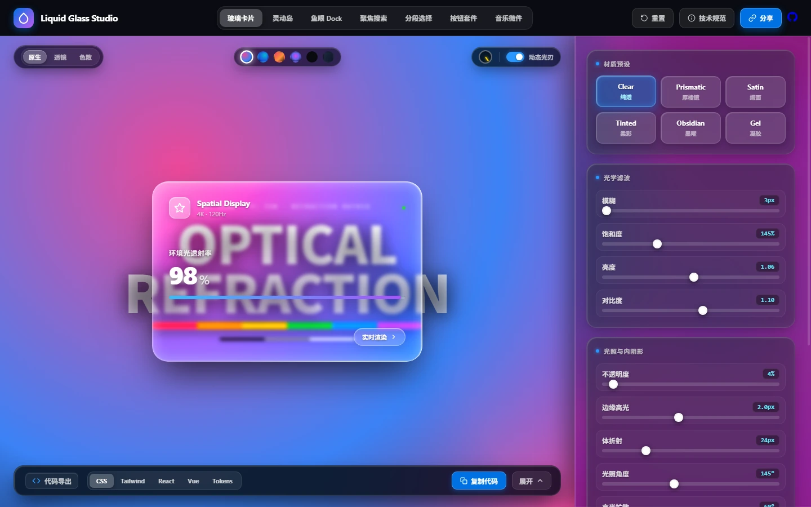
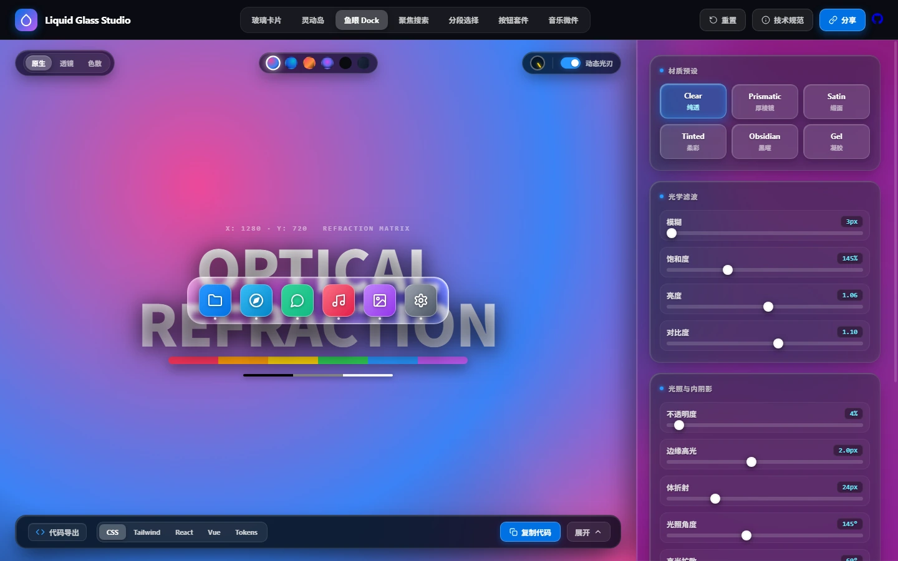
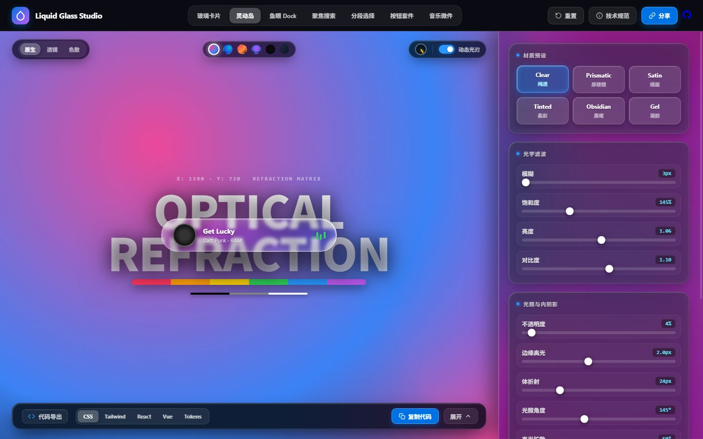
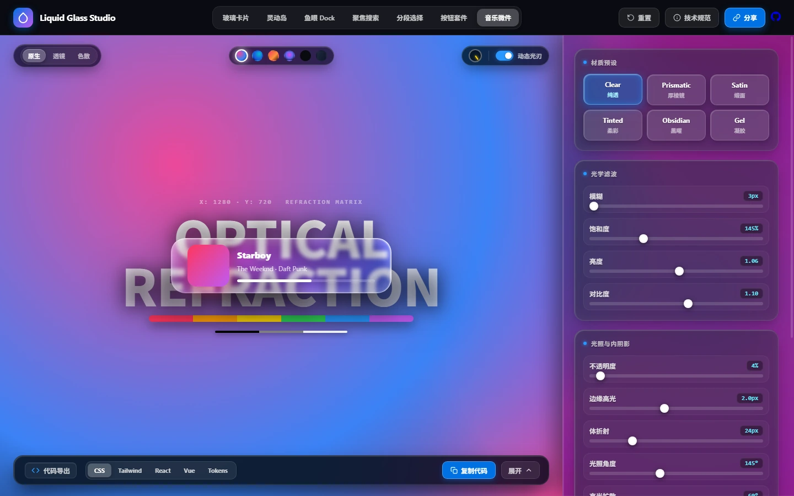
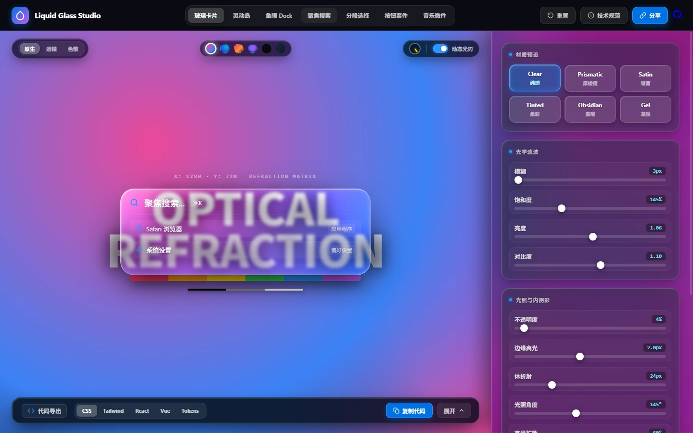
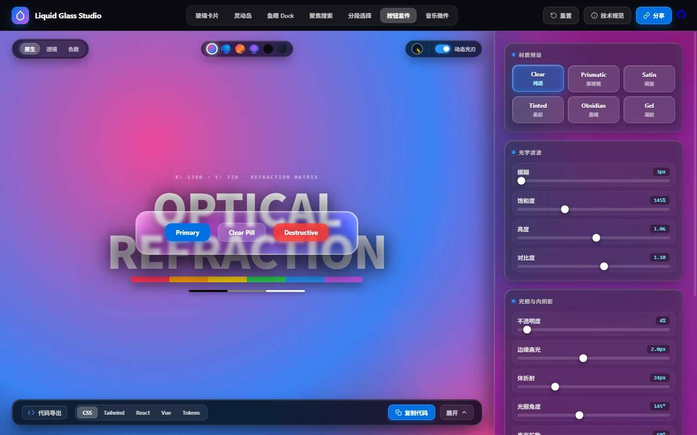

# Apple Liquid Glass Studio (WWDC25 HIG)

<p align="center">
  <a href="README.md">简体中文</a> •
  <a href="README_EN.md"><strong>English</strong></a> •
  <a href="README_JA.md">日本語</a>
</p>

<p align="center">
  
</p>

<p align="center">
  <strong>Beyond Milky Blur — Returning to Optical Crystal Translucency: Apple-Grade Liquid Glass Optics Engine & Complete HIG Design System (WWDC25)</strong><br>
  98% Pure Transmittance · Real SDF Normal Refraction · Zero-Shift 4-Layer Inset Scatter · Zero Dependencies
</p>

<p align="center">
  <a href="https://pandajs404.github.io/liquid-glass/"></a>
  
  
  
  
  
  
</p>

---

## 💎 Why Optical Translucency Matters

Conventional web implementations of frosted glass suffer from three fundamental optical flaws:
- ❌ **Milky & Foggy Pastes**: Blindly stacking 20px+ gaussian blur with an opaque white wash turns the glass into bathroom acrylic, erasing background detail and flattening depth.
- ❌ **Cardboard 1px Gray Borders**: Using crude `border: 1px solid rgba(255,255,255,0.2)` draws an unnatural, muddy outline around the glass, destroying the organic light blade and crystal rim reflections found in real lenses.
- ❌ **Flat Zero-Refraction Surfaces**: Background pixels are blurred linearly with zero optical warping, missing the lens curvature and chromatic dispersion characteristic of Apple's physical glass.

### ✨ The Pure Translucency Breakthrough

1. 🪞 **98% Crystal Transmittance & Micro-Leveling**  
   Calibrated low-scatter micro-blur (3px ~ 6px) combined with micro-boosted saturation (145% ~ 175%) and ambient shadow lifting ensures underlying text, typography, and spectrum bars remain crisp, legible, and vibrant.
2. 🌈 **SDF Convex Normal Field & 3-Channel RGB Dispersion**  
   Dynamically generates lens surface normal gradients using a Signed Distance Field (SDF). Driven by SVG `<feDisplacementMap>`, background elements bend organically around squircle edges with prismatic rainbow separation.
3. 📐 **Zero-Shift 4-Layer Physical Inset Scatter**  
   Completely discards reflow-inducing borders. Instead, four layers of physical inset scatter shadows replicate bevel specular glints, secondary bounce light, and volumetric bloom with exactly zero layout shifts (0 reflows).
4. 🗡️ **360° Conic Specular Rim**  
   Calculates live light blade travel along squircle bevels in real time, cascading across the perimeter as light angles shift or cursors glide.
5. 🧼 **Ruthless De-noising & Pure Layout**  
   Stripped of redundant marketing badges, tutorial crutches, and explanatory clutter. The interface is self-explanatory, letting users focus entirely on the beauty of refracted light.

---

## 📸 Visual Gallery

> All visual assets have been upgraded to lightweight, ultra-crisp **WebP** format.

### 1. Interactive Studio & Inspector
Integrated with a high-contrast calibration plate (Typography Refraction Matrix & Vivid Color Spectrum). Drag cards anywhere across the stage to inspect 98% pure transmittance:
<p align="center">
  
</p>

### 2. macOS Fisheye Magnification Dock
Genuine macOS dock shelf physics where magnified icons lift smoothly beyond container boundaries without clipping:
<p align="center">
  
</p>

### 3. Dynamic Island Capsule & Apple Music Widget
Micro-beveled crystal wrapping with live reactive waveform audio visualization:
<p align="center">
  
  
</p>

### 4. Spotlight Command Palette & Multi-state Liquid Buttons
Floating crystalline search hub with tactile responsive action buttons:
<p align="center">
  
  
</p>

---

## 🔬 Optical Physics & Rendering Pipeline

```
┌─────────────────────────────────────────────────────────────┐
│          High-Contrast Background Typography & Spectrum     │
└──────────────────────────────┬──────────────────────────────┘
                               │ Incident Ray Transmission
                               ▼
┌─────────────────────────────────────────────────────────────┐
│  1. 98% Transmittance Micro-Leveling (HIG Filter)            │
│     • Low-Scatter Gaussian Blur (3px ~ 6px, no milky paste)  │
│     • Chromatic Saturation Surge (145% ~ 175%)              │
│     • Ambient Shadow Lift (Brightness: 1.05)                 │
│     • Crystal Edge Contrast Boost (Contrast: 1.06)           │
└──────────────────────────────┬──────────────────────────────┘
                               │ Optical Refraction
                               ▼
┌─────────────────────────────────────────────────────────────┐
│  2. SDF Convex Normal Refraction & RGB Dispersion            │
│     • Dynamic Signed Distance Field gradient normal vector   │
│     • SVG <feDisplacementMap> warps underlying background    │
│     • RGB 3-channel wavelength separation for prism glints   │
└──────────────────────────────┬──────────────────────────────┘
                               │ Specular Edge Sculpting
                               ▼
┌─────────────────────────────────────────────────────────────┐
│  3. Zero-Shift 4-Layer Inset Scatter Box-Shadows             │
│     • Specular Rim Inset (1.5px @ 75% Alpha)                 │
│     • Secondary Bounce Inset (1.5px @ 15% Alpha)             │
│     • Deep Volumetric Bloom (10px ~ 18px Inset)              │
│     • Zero-Contact Ambient Drop Shadow (0 24px 50px)         │
│     • Strictly 0px border (eliminates muddy gray outline)    │
└──────────────────────────────┬──────────────────────────────┘
                               │ Dynamic Illumination
                               ▼
┌─────────────────────────────────────────────────────────────┐
│  4. 360° Conic Specular Rim Glint                            │
│     • Vector angle tracking & pointer-following conic sweep  │
└─────────────────────────────────────────────────────────────┘
```

---

## 💎 6 Calibrated Physical Materials

| Preset Material | Primary Use Case | Blur | Base Alpha | Saturation | Contrast | Optical Translucency Profile |
| :--- | :--- | :---: | :---: | :---: | :---: | :--- |
| **Clear** | Viewfinders, thick lenses, inspection view | `4px` | `4%` | `150%` | `1.08` | **Ultra-Translucent**, razor-sharp background typography with crystal edge refraction |
| **Prismatic** | System core cards, Control Center, islands | `5px` | `8%` | `175%` | `1.06` | **Flagship Apple HIG Prismatic**, rich transmittance with RGB rainbow dispersion glints |
| **Satin** | Sidebars, drawers, modal sheet backgrounds | `18px` | `14%` | `160%` | `1.03` | Silky, ultra-fine acrylic haze, maintaining high text readability |
| **Tinted** | Active states, media dashboards, hero cards | `8px` | `10%` | `210%` | `1.05` | Adaptive ambient tinting, harmonizing with backdrop without muddiness |
| **Obsidian** | Dark HUDs, pro audio consoles | `6px` | `32%` | `130%` | `1.10` | Space-black light absorber with high-contrast platinum/gold edge facets |
| **Gel** | Bouncy toggles, floating indicator capsules | `8px` | `12%` | `195%` | `1.04` | Viscous fluid with surface-tension highlights and subtle center lensing |

---

## 🧩 Complete Suite of 7 Apple HIG Carriers

1. **Master Glass Card**: 98% transmittance hovering slab with full unconstrained dragging across calibration targets.
2. **macOS Fisheye Magnification Dock**: Genuine bottom-anchored magnification physics with upward icon lift.
3. **Dynamic Island**: Capsule micro-interactions with real-time responsive audio waveform.
4. **Spotlight Search Hub**: Crystalline command hub accessible instantly via keyboard shortcut.
5. **Segmented Controls**: Fluid sliding tab switches with tactile spring physics.
6. **Multi-state Liquid Button Suite**: Micro-interaction states across default, focus, and pressed configurations.
7. **Apple Music Now Playing Widget**: Immersive media playback card bathed in ambient refractions.

---

## ⚡ Quick Start

### 1. Instant Offline Launch
Built strictly with vanilla HTML5, CSS3, and ES Modules. **Zero npm install, zero build step**:

```bash
# 1. Clone repository
git clone git@github.com:pandaJS404/liquid-glass.git
cd liquid-glass

# 2. Option A: Direct double-click
open index.html

# 3. Option B: Lightweight local server (recommended for full SVG refraction)
python -m http.server 8088
# Navigate to http://localhost:8088/ in your browser
```

### 2. Standalone CSS Integration
Eliminate muddy 1px gray borders and embrace the crystal translucency formula:

```css
.liquid-glass-translucent {
  width: 480px;
  height: 320px;
  border-radius: 28px;
  border: none; /* No 1px gray borders */
  
  /* 98% pure transmittance micro-leveling */
  background: rgba(255, 255, 255, 0.04);
  -webkit-backdrop-filter: blur(4px) saturate(150%) brightness(1.05) contrast(1.06);
  backdrop-filter: blur(4px) saturate(150%) brightness(1.05) contrast(1.06);
  
  /* Zero-shift 4-layer crystal inset scatter */
  box-shadow:
    inset 1.5px 1.5px 2px 0 rgba(255, 255, 255, 0.75),
    inset -1.5px -1.5px 2px 0 rgba(255, 255, 255, 0.15),
    inset 0 0 10px 2px rgba(255, 255, 255, 0.18),
    inset 0 0 18px 4px rgba(255, 255, 255, 0.08),
    0 24px 50px -12px rgba(0, 0, 0, 0.65);
    
  position: relative;
  overflow: visible;
}
```

---

## 🔗 URL Hash Deep Linking Protocol

All optical parameters are bidirectionally synchronized with URL Hash, making design reviews and token handoffs seamless:

```text
https://pandajs404.github.io/liquid-glass/#mat=clear&comp=card&blur=4&sat=150&bright=1.05&contrast=1.06&fill=4&rim=1.8&bloom=18&angle=145&spread=60&w=480&h=320&r=28
```

---

## 🌐 Browser Support & Graceful Degradation

| Feature | Chrome / Edge (Chromium) | Safari (WebKit) | Firefox (Gecko) |
| :--- | :---: | :---: | :---: |
| **98% Transmittance Micro-Leveling** | ✅ Native | ✅ Native | ✅ Native |
| **4-Layer Inset Scatter (No Border)** | ✅ Native | ✅ Native | ✅ Native |
| **Conic Specular Rim** | ✅ Native | ✅ Native | ✅ Native |
| **SVG SDF Normal Refraction** | ✅ Native | ⚡ Sub-surface Scatter Fallback | ⚡ Sub-surface Scatter Fallback |
| **Accessibility Contrast Fallback** | ✅ WCAG 2.2 AA | ✅ WCAG 2.2 AA | ✅ WCAG 2.2 AA |

---

## 📄 License

Distributed under the [MIT License](LICENSE). Open for commercial and personal projects.

Designed with ❤️ to celebrate the purest optical translucency of Apple Human Interface Guidelines.
