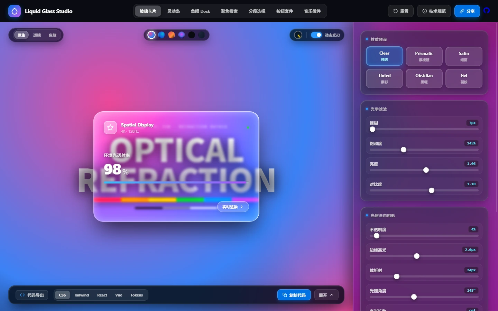
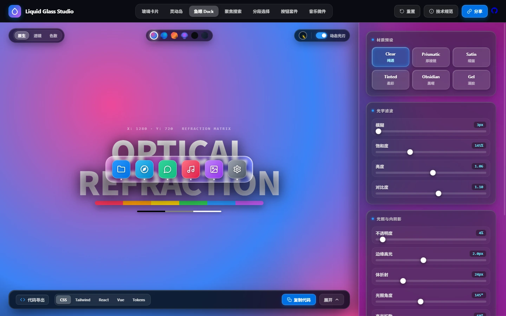
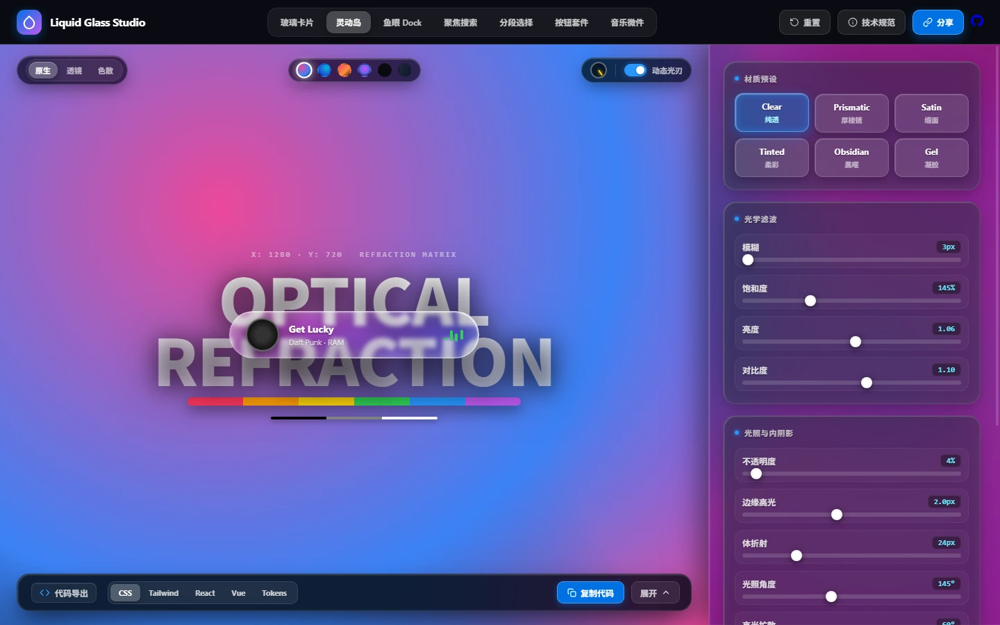
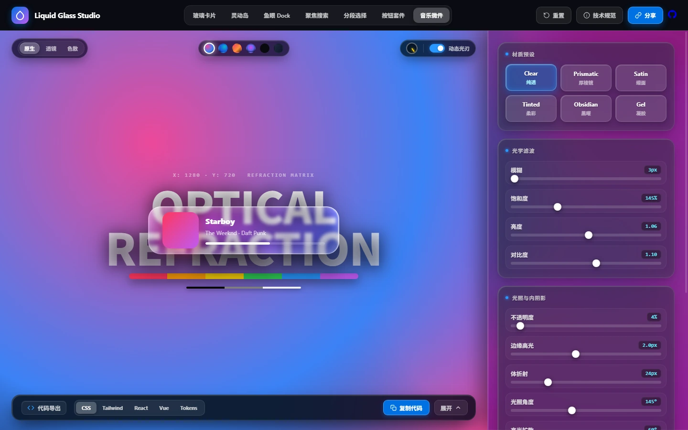
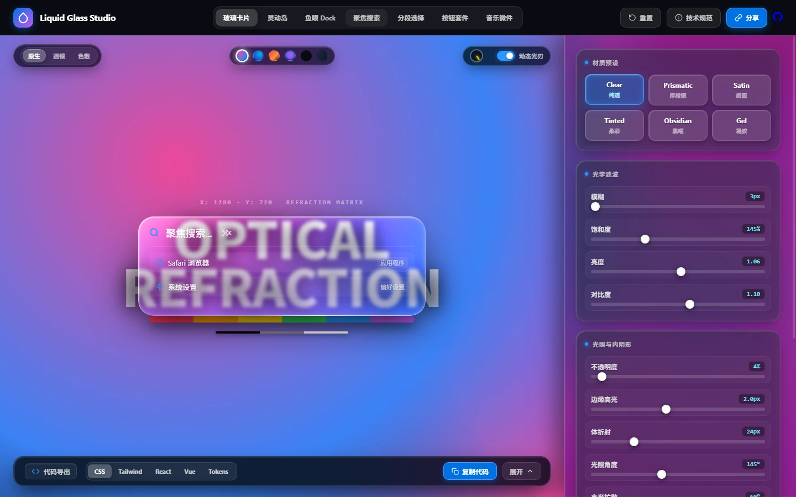
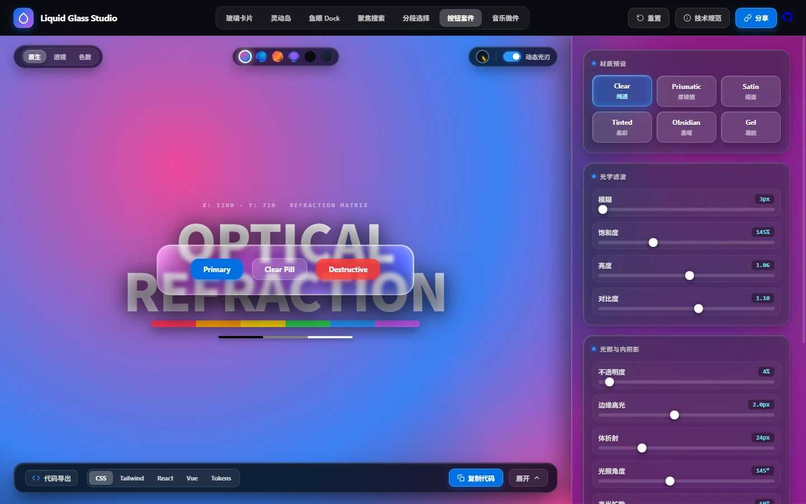

# Apple Liquid Glass Studio (WWDC25 HIG)

<p align="center">
  <a href="README.md">简体中文</a> •
  <a href="README_EN.md">English</a> •
  <a href="README_JA.md"><strong>日本語</strong></a>
</p>

<p align="center">
  
</p>

<p align="center">
  <strong>白濁した磨りガラスを排し、圧倒的な透明感へ —— Apple 公式級リキッドガラス光学屈折エンジン＆完全デザインシステム (WWDC25 HIG)</strong><br>
  98% 純光透過率 · リアルなSDF法線屈折 · レイアウトシフトゼロの4層物理内シャドウ · 完全依存ゼロ
</p>

<p align="center">
  <a href="https://pandajs404.github.io/liquid-glass/"></a>
  
  
  
  
  
  
</p>

---

## 💎 なぜ「圧倒的な透明感」を追求するのか？

従来のWeb制作における「すりガラス（Frosted Glass）」には深刻な光学的欠陥がありました：
- ❌ **白濁した不自然なモヤ（Milky & Foggy）**：20px以上の強いガウスブラーに白い半透明レイヤーを重ねるだけで、まるで安価なアクリル板のように背後の情報が失われ、立体感や輝きが損なわれていました。
- ❌ **硬直した1pxの死線ボーダー**：粗雑な `border: 1px solid rgba(255,255,255,0.2)` はガラスの周囲に不快な灰色の輪郭を作り出し、本物のレンズに見られる連続的なハイライト光刃を台無しにしていました。
- ❌ **歪みのないフラットなぼかし**：背景が単に均一にぼかされるだけで、曲面レンズを光が通過する際の光学的な屈折や分散が完全に欠落していました。

### ✨ 本エンジンがもたらす光学的ブレイクスルー

1. 🪞 **98% 純光透過率＆マイクロ・レベリング（Micro-Leveling Optics）**  
   低分散のマイクロブラー（3px 〜 6px）と色彩彩度の増強（145% 〜 175%）、暗部ブーストを融合。ガラス背面のタイポグラフィやカラーバーが鮮明かつ鋭利に透過します。
2. 🌈 **SDFレンズ法線場＆3チャンネル色分散（SDF Normal Refraction & RGB Dispersion）**  
   符号付き距離場（SDF）に基づき、レンズ表面の法線ベクトル場を動的生成。SVG `<feDisplacementMap>` によりエッジの背景歪みとプリズム状の虹色分散を忠実にシミュレート。
3. 📐 **ゼロ・レイアウトシフト（4層インセット物理シャドウ）**  
   透明感を阻害する1pxボーダーを完全撤廃。面取り主光刃、二次反射バックライト、深層ボリュームブルーム、環境光を組み合わせた4層インセットシャドウにより、リフロー（再レイアウト）ゼロで極上の結晶質感を表現。
4. 🗡️ **360° 円錐追従ハイライト（Conic Specular Rim）**  
   光の入射角とカーソルの動きに合わせて、角丸（Squircle）の周りを滑らかに巡るダイナミックな光刃をリアルタイム計算。
5. 🧼 **極限まで削ぎ落とされたクリーンUI（Ruthless De-noising）**  
   冗長な宣伝文句や操作説明ラベルをすべて排除。光とガラスの本質だけに集中できる自明なデザイン。

---

## 📸 ビジュアルギャラリー (Visual Gallery)

> すべての画像アセットは高精細・軽量な **WebP** 形式に完全移行されています。

### 1. スタジオ＆インスペクター (Studio & Inspector)
光学屈折マトリクス＆高彩度スペクトル層を内蔵。カードを自由かつ滑らかにドラッグし、98%の透過率とエッジの屈折をリアルタイムに検証：
<p align="center">
  
</p>

### 2. macOS 魚眼拡大Dock (Fisheye Magnification Dock)
ホバー時にアイコンが滑らかに境界を超えて拡大し、底面の透明カプセルトレイに吸着する物理特性を再現：
<p align="center">
  
</p>

### 3. Dynamic Island ＆ Apple Music ウィジェット (Island & Music Widget)
繊細な光刃に包まれた透明感と、リアルタイムに反応するオーディオスペクトラム：
<p align="center">
  
  
</p>

### 4. Spotlight 検索＆多態リキッドボタンスイート (Spotlight & Button Suite)
宙に浮かぶ高透過ハブと、心地よい触覚フィードバックを備えたボタンスイート：
<p align="center">
  
  
</p>

---

## 🔬 光学物理原理＆レンダリングパイプライン

```
┌─────────────────────────────────────────────────────────────┐
│        背景の高コントラスト・タイポグラフィ＆スペクトル層         │
└──────────────────────────────┬──────────────────────────────┘
                               │ 入射光の透過
                               ▼
┌─────────────────────────────────────────────────────────────┐
│  1. 98% 純光マイクロ・レベリング (Luminosity Re-leveling)    │
│     • 低分散ガウスブラー (Blur: 3px 〜 6px、白濁を完全排除)   │
│     • 彩度ブースト (Saturate: 145% 〜 175%、鮮やかな透過光)  │
│     • 暗部透過リフト (Brightness: 1.05)                      │
│     • 結晶エッジコントラスト (Contrast: 1.06)                │
└──────────────────────────────┬──────────────────────────────┘
                               │ 光学屈折
                               ▼
┌─────────────────────────────────────────────────────────────┐
│  2. SDF 凸面レンズ法線屈折＆RGB 3チャンネル分散               │
│     • 符号付き距離場によるエッジ法線ベクトルの動的計算         │
│     • SVG <feDisplacementMap> による背景ジオメトリの歪み     │
│     • RGB分離によるプリズム状の虹色分散ハイライト              │
└──────────────────────────────┬──────────────────────────────┘
                               │ 光刃・陰影の形成
                               ▼
┌─────────────────────────────────────────────────────────────┐
│  3. ゼロ・レイアウトシフト 4層インセット物理シャドウ          │
│     • 面取り主光刃 (Specular Rim Inset: 1.5px @ 75% Alpha)   │
│     • 二次反射バックライト (Secondary Bounce: 1.5px @ 15%)   │
│     • 深層ボリュームブルーム (Deep Volume Bloom: 10px〜18px) │
│     • 浮遊ドロップシャドウ (Drop Shadow: 0 24px 50px)        │
│     • 1pxの死線ボーダーを完全排除                             │
└──────────────────────────────┬──────────────────────────────┘
                               │ 動的イルミネーション
                               ▼
┌─────────────────────────────────────────────────────────────┐
│  4. 360° 円錐追従ハイライト光刃 (Conic Specular Rim)          │
│     • 光源角度追従＋ポインター移動によるリング状マスク計算    │
└─────────────────────────────────────────────────────────────┘
```

---

## 💎 公式6大物理マテリアルシステム

| プリセット | 主な用途 | ブラー | 基底透過 | 彩度 | コントラスト | 光学透過特性 |
| :--- | :--- | :---: | :---: | :---: | :---: | :--- |
| **Clear 純透** | 厚板ガラス、ファインダー、精密レンズ | `4px` | `4%` | `150%` | `1.08` | **最高峰の透明感**。背後の文字がくっきり見え、エッジが結晶のように屈折 |
| **Prismatic 厚棱鏡** | システム主要カード、Control Center、浮島 | `5px` | `8%` | `175%` | `1.06` | **王道 Apple HIG プリズム**。高透過と虹色分散光刃の共演 |
| **Satin スモーク** | サイドバー、設定パネル、シート背景 | `18px` | `14%` | `160%` | `1.03` | なめらかなアクリル微霧質感。高い文字可読性を両立 |
| **Tinted カラー** | フォーカス時、メディアパネル、heroカード | `8px` | `10%` | `210%` | `1.05` | 背景色を美しく吸収・反射する環境混色。濁りのない鮮やかさ |
| **Obsidian 黒曜石** | ダークHUD、プロ向けオーディオ盤面 | `6px` | `32%` | `130%` | `1.10` | スペースブラックの光吸収体。高コントラストなゴールド/プラチナ光刃 |
| **Gel ジェル** | トグルスイッチ、フローティングカプセル | `8px` | `12%` | `195%` | `1.04` | 表面張力のある高粘性流体。中心に向かって穏やかに集光 |

---

## 🧩 完全網羅された7つのApple HIGキャリア

1. **マスターグラスカード (Master Glass Card)**：98%の透過率を誇る浮遊スラブ。全画面スムーズにドラッグ可能。
2. **macOS 魚眼拡大Dock (Fisheye Dock)**：下部接地かつ上部へ飛び出すリアルな物理拡大を再現。
3. **Dynamic Island**：ライブオーディオ波形とシステムステータスを内包するカプセル。
4. **Spotlight 検索ハブ**：ショートカットで即座に展開する透明コマンドハブ。
5. **セグメントコントロール**：心地よいスプリング弾性を持つスライダー切り替え。
6. **マルチステート・リキッドボタンスイート**：通常・フォーカス・押下の3状態を再現する微細光刃ボタン。
7. **Apple Music 再生ウィジェット**：音と光が織りなす没入型ガラスウィジェット。

---

## ⚡ クイックスタート (Quick Start)

### 1. インストール不要のローカル実行
外部ビルドツールや **npm 依存関係は一切不要** です：

```bash
# 1. リポジトリをクローン
git clone git@github.com:pandaJS404/liquid-glass.git
cd liquid-glass

# 2. 方法A: index.html をブラウザで直接開く
open index.html

# 3. 方法B: Pythonの簡易サーバーを起動（SVG屈折完全対応・推奨）
python -m http.server 8088
# ブラウザで http://localhost:8088/ を開く
```

### 2. プロジェクトで使える純透 CSS
1pxの灰色ボーダーを捨て、物理内シャドウの計算式を適用：

```css
.liquid-glass-translucent {
  width: 480px;
  height: 320px;
  border-radius: 28px;
  border: none; /* 1pxの死線を排除し、純粋な透明感を維持 */
  
  /* 98%純光透過マイクロ・レベリング */
  background: rgba(255, 255, 255, 0.04);
  -webkit-backdrop-filter: blur(4px) saturate(150%) brightness(1.05) contrast(1.06);
  backdrop-filter: blur(4px) saturate(150%) brightness(1.05) contrast(1.06);
  
  /* ゼロ・レイアウトシフト 4層インセット物理シャドウ */
  box-shadow:
    inset 1.5px 1.5px 2px 0 rgba(255, 255, 255, 0.75),
    inset -1.5px -1.5px 2px 0 rgba(255, 255, 255, 0.15),
    inset 0 0 10px 2px rgba(255, 255, 255, 0.18),
    inset 0 0 18px 4px rgba(255, 255, 255, 0.08),
    0 24px 50px -12px rgba(0, 0, 0, 0.65);
    
  position: relative;
  overflow: visible;
}
```

---

## 🔗 URL Hash ディープリンク仕様

すべての光学パラメータは URL Hash と双方向同期され、チーム間での共有が瞬時に行えます：

```text
https://pandajs404.github.io/liquid-glass/#mat=clear&comp=card&blur=4&sat=150&bright=1.05&contrast=1.06&fill=4&rim=1.8&bloom=18&angle=145&spread=60&w=480&h=320&r=28
```

---

## 🌐 ブラウザ互換性とフォールバック

| 機能 | Chrome / Edge (Chromium) | Safari (WebKit) | Firefox (Gecko) |
| :--- | :---: | :---: | :---: |
| **98% 透過マイクロ・レベリング** | ✅ ネイティブ対応 | ✅ ネイティブ対応 | ✅ ネイティブ対応 |
| **4層インセット物理シャドウ** | ✅ ネイティブ対応 | ✅ ネイティブ対応 | ✅ ネイティブ対応 |
| **動的円錐ハイライト光刃** | ✅ ネイティブ対応 | ✅ ネイティブ対応 | ✅ ネイティブ対応 |
| **SVG SDF法線屈折＆色分散** | ✅ ネイティブ対応 | ⚡ 物理散乱フォールバック | ⚡ 物理散乱フォールバック |
| **アクセシビリティ（高コントラスト）** | ✅ WCAG 2.2 AA | ✅ WCAG 2.2 AA | ✅ WCAG 2.2 AA |

---

## 📄 ライセンス (License)

本プロジェクトは [MIT License](LICENSE) のもとで公開されており、商用・個人利用を問わず自由にご活用いただけます。

Designed with ❤️ to celebrate the purest optical translucency of Apple Human Interface Guidelines.
